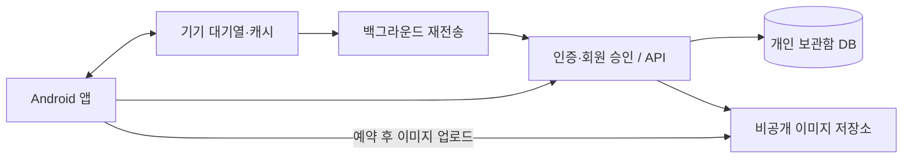

# LinkFileBox

**흩어진 링크를 모으고, 기억나는 단서로 다시 찾으세요.**

Android 공유 메뉴로 링크를 저장하고, 제목·메모·분류와 첨부 이미지의 인식 텍스트로
다시 찾는 개인 링크 보관함입니다. 찾은 링크는 원래 앱이나 브라우저에서 엽니다.

> **개발 중:** Google 로그인과 관리자 승인이 필요합니다.
> 실제 사용자 품질 평가와 운영 배포 인수는 미완료이며, 공개 출시·외부 베타 준비 완료 상태는 아닙니다.

[주요 기능](#주요-기능) · [시작하기](#시작하기) · [지원 범위](#지원-범위와-제한)

## 화면 미리보기

<table width="100%">
  <tr>
    <th width="50%" align="center">내 보관함</th>
    <th width="50%" align="center">검색 필터</th>
  </tr>
  <tr>
    <td align="center" valign="top"></td>
    <td align="center" valign="top"></td>
  </tr>
  <tr>
    <td align="center">제목·출처·메모를 읽고<br>저장한 링크를 다시 찾습니다.</td>
    <td align="center">조건을 고른 뒤 필터 적용으로<br>결과에 반영합니다.</td>
  </tr>
  <tr>
    <th align="center">검색 · 결과가 없는 상태</th>
    <th align="center">다크 테마 · 큰 글꼴</th>
  </tr>
  <tr>
    <td align="center" valign="top"></td>
    <td align="center" valign="top"></td>
  </tr>
  <tr>
    <td align="center">제목·URL·메모로 검색하며,<br>결과가 없으면 안내를 표시합니다.</td>
    <td align="center">어두운 배경과 큰 글꼴로<br>링크의 제목과 메모를 읽습니다.</td>
  </tr>
</table>

위 이미지는 **기존 QA 캡처**입니다. 내 보관함·검색 필터·다크 테마는
합성 자료로 실제 Compose 컴포넌트를 렌더링한 화면이며, 검색은 결과가 없는 상태의 앱 화면입니다.
실제 회원 자료나 SNS 앱 연동 성공의 증거는 아닙니다.
이미지는 원본 비율을 유지하며, 검색 필터에는 높이를 맞추기 위한 상하 여백을 추가했습니다.

## 왜 LinkFileBox인가

관심 있는 글·장소·제품을 여러 앱에 저장하다 보면 **어디에 저장했는지부터 잊기 쉽습니다.**
LinkFileBox는 원문을 복제하는 대신 링크와 기억할 단서를 모읍니다.

- **한곳에 보관:** 출처가 달라도 링크를 같은 개인 보관함에 저장합니다.
- **기억으로 다시 찾기:** 제목·메모·확보한 메타정보·OCR 텍스트를 검색과 분류에 활용합니다.
- **원문으로 돌아가기:** 찾은 항목에서 원래 게시물을 엽니다.

원문 사이트의 로그인 요구나 게시물 삭제는 LinkFileBox에서 해결하지 않습니다.

## 사용 흐름

1. **공유하기:** 다른 앱의 Android 공유 메뉴에서 링크를 보내거나 URL을 붙여넣습니다.
2. **저장하기:** 링크를 확인한 뒤 저장 버튼으로 확정합니다. 제목·메모는 접힌 선택 입력이며, 여러 링크가 있으면 하나를 선택합니다.
3. **다시 찾기:** 내 보관함에서 검색하거나 출처·기간·분류로 좁힙니다.
4. **원문 열기:** 찾은 항목을 원래 앱이나 브라우저에서 엽니다.

보관함의 출처별 바로가기에서 전체·Instagram·Threads·네이버 블로그·기타를 선택할 수 있습니다.
목록의 출처 배지는 이름과 색상으로 구분하며, 바로가기는 이전 검색 조건을 초기화하고 해당 출처의 서버 검색 결과를 엽니다.
현재 불러온 페이지에만 적용하는 필터가 아니며, 그 밖의 서비스는 `기타`에 포함됩니다.

상세 화면은 제목·내용과 링크·날짜·분류를 중심으로 보여주며, 오른쪽 위에서 목록으로 돌아갑니다.
목록에서도 삭제를 요청할 수 있고, 확인 전에는 삭제되지 않습니다.
분류 수정은 상세의 더보기에서 선택하면 바로 선택 창이 열립니다.
`제목/내용 수정`에는 현재 제목과 내용이 채워지며, 변경한 항목만 저장합니다.
첨부 이미지는 내용 아래에 표시하고 그 자리에서 추가·변경·삭제합니다. OCR 버튼·상태 표시는 노출하지 않습니다.

이미지를 첨부할 때는 저장된 항목과 사진을 직접 선택합니다.
연결이 끊기면 전송 대기 상태를 확인하고, 재연결 후 서버 저장 결과를 확인합니다.

## 주요 기능

| 기능               | 할 수 있는 일                                                            |
| ------------------ | ------------------------------------------------------------------------ |
| 빠르게 저장        | Android 공유 메뉴·URL 직접 입력, 제목·메모 편집                          |
| 단서로 검색        | 키워드·정해진 별칭 검색, 출처·기간·분류·미분류 필터                      |
| 내 방식으로 정리   | 규칙 기반 자동 분류, 사용자 분류 생성·수정, 직접 지정과 자동 분류 재적용 |
| 이미지로 단서 추가 | 항목당 이미지 1장 첨부·교체·삭제, 기기 내 한국어·라틴 OCR                |
| 연결이 끊겨도 대기 | 저장·편집 등의 대기열, 마지막 서버 목록·상세 캐시와 동기화 시각 확인     |
| 데이터 관리        | 서버 항목 삭제, Google 재인증 기반 계정 탈퇴                             |

앱은 `내 보관함`에서 시작합니다. 하단의 보관함·검색·설정과 별도 `링크 저장` 버튼으로 이동합니다.
라이트·다크 테마와 앱에 포함된 Pretendard를 사용합니다.

## 시작하기

### 이용 조건

- **Android 8.0 이상**이 필요합니다.
- Google 로그인 후 **관리자 승인**을 받아야 서버 보관함을 사용할 수 있습니다.
- 승인 회원 최대 6명의 초기 베타 설정입니다. 승인 대기는 오류가 아닙니다.
- 아래 개발용 빌드는 공개 배포나 외부 베타 참여 경로가 아닙니다.

### 개발자용 로컬 실행

Android Studio·JDK 17·Android SDK 35, Node.js 24와 Docker Desktop이 필요합니다.
Google OAuth 등록, 로컬 서버 설정, 앱 연결 설정을 마친 후 빌드합니다.

다음 순서로 진행하세요.

1. 개발 도구와 Google OAuth 클라이언트를 준비합니다.
2. 의존성을 설치하고 로컬 Supabase·마이그레이션·작업 실행기를 설정합니다.
3. 앱의 서버 주소·공개 API 키·Google 웹 Client ID를 설정합니다.
4. 아래 명령으로 빌드한 뒤 기기에 설치하고 로그인·회원 승인을 확인합니다.

```powershell
# 저장소 루트의 Windows PowerShell — 위 설정을 마친 후 실행
.\android\gradlew.bat -p android :app:assembleDebug
```

APK: `android/app/build/outputs/apk/debug/app-debug.apk`

**설정 없이도 빌드는 되지만 로그인·서버 보관함은 사용할 수 없습니다.**
Gradle은 루트 `.env`를 자동으로 읽지 않습니다. 앱에는 서버 비밀키를 넣지 마세요.

실기기 로컬 통합 검사는 테스트 전용 기기에서만 실행합니다. 앱을 설치하고 기존 앱 세션에서
로그아웃하므로 개인 사용 세션에는 실행하지 마세요. 로컬 서버·작업 실행기가 준비되어 있어야 하며,
화면 잠금을 해제한 상태에서 `adb -s <serial> reverse tcp:18021 tcp:18021`로 연결합니다.
`LINK_VAULT_TEST_DEVICE_SERIAL=<serial>`을 명시해 `npm run test:emulator-integration`을 실행하면
에뮬레이터 대신 지정한 기기를 사용합니다. Debug에서만 `http://127.0.0.1:18021`을 허용하며
Release의 HTTPS 정책은 유지합니다. 종료 후에는 해당 reverse 연결을 해제하세요.
`LINK_VAULT_TEST_FIXTURE`는 기본 `generic`(example.com), `threads`, `instagram-travel` 중
선택하며, 마지막 항목은 실제 한국어 게시물의 여행 분류도 검사합니다.
실행 중 USB 재연결로 reverse 연결이 사라지면 지정한 테스트 포트만 재설정합니다.
`LINK_VAULT_TEST_DIAGNOSTICS=1`은 생성한 테스트 항목의 처리 상태·제목 확보 여부와 경과 시간을
출력합니다. 계정 토큰·비밀번호·원문 내용은 진단 로그에 출력하지 않습니다.

### 정적 사이트의 웹 계정 탈퇴 설정

`website/`는 별도 정적 사이트 배포 대상입니다. API·DB 배포 워크플로
(`.github/workflows/deploy.yml`)는 사이트나 웹 설정을 생성·배포하지 않습니다.
`/account-deletion/config.json`이 없거나 유효하지 않으면 웹 계정 탈퇴·상태 조회는
기본적으로 비활성화되며, 설정 생성만으로 운영 배포나 공개 출시가 승인되지는 않습니다.

배포 시 `website/` 내용을 **저장소 밖의 별도 staging 디렉터리**에 먼저 준비하고,
배포 환경에 다음 값을 제공한 뒤 공개 설정을 생성합니다. 루트 `.env`는 자동으로 읽지 않습니다.

- `SUPABASE_URL`: 정확히 `https://api.linkfilebox.com` (끝의 `/` 없이).
- `SUPABASE_PUBLISHABLE_KEY`: 해당 서버의 `sb_publishable_…` 공개 키 또는 역할이 `anon`인
  기존 JWT 공개 키. `sb_secret_…`·`service_role` 키와 서버 비밀키는 넣지 마세요.
- `GOOGLE_WEB_CLIENT_ID`: 아래 고정값으로, 웹 모듈의 `GOOGLE_CLIENT_ID`와 같아야 합니다.

```powershell
# 공개 키는 배포 환경에서 SUPABASE_PUBLISHABLE_KEY로 사전 제공합니다.
# staging의 account-deletion 디렉터리는 이미 존재해야 합니다.
$env:SUPABASE_URL = "https://api.linkfilebox.com"
$env:GOOGLE_WEB_CLIENT_ID = "486032328491-4sv6bg4ukablou6d2btfnhon30e10rsb.apps.googleusercontent.com"
npm run build:web-account-config -- --output C:\deploy\linkfilebox-static\account-deletion\config.json
```

출력 경로는 `--output`으로 반드시 지정해야 하며, 심볼릭 링크를 해석한 부모 디렉터리가
저장소 안이면 거부합니다. 생성기는 웹 모듈의 기존 공개 설정 검증을 재사용하여 주소·Client ID와
공개 키 형식을 검사합니다. 이는 키의 서버 소속이나 JWT 서명 검증은 아니므로 배포자가 확인해야 합니다.
키·설정 내용·출력 경로는 로그에 표시하지 않으며, 같은 디렉터리의 임시 파일을 완성한 뒤
지정한 출력 파일만 원자적으로 교체하므로 같은 명령을 다시 실행할 수 있습니다.
생성 파일은 POSIX에서 소유자만 읽고 쓰는 권한(`0600`)을 사용합니다. Windows에서는 staging의
ACL을 별도로 제한하고, 게시할 때 필요한 웹 서버 계정의 읽기 권한을 배포 과정에서 부여하세요.

생성한 파일은 공개 정보만 담으며, 정적 사이트와 함께
`https://linkfilebox.com/account-deletion/config.json`으로 게시해야 합니다.
키가 들어 있는 생성 파일을 저장소에 추가하거나 설정을 로그에 출력하지 마세요.
이 명령은 로컬 파일만 생성하며 서버·OAuth 설정 변경이나 사이트 게시를 수행하지 않습니다.

## 지원 범위와 제한

| 구분           | 현재 범위                                                                                         |
| -------------- | ------------------------------------------------------------------------------------------------- |
| 플랫폼         | Android 전용. iOS·PC 웹은 현재 제공하지 않음                                                      |
| 보관 한도      | 회원별 항목 100개, 새 항목 분당 10건. 사용자 분류 30개, 항목당 분류 연결 5개                      |
| 자동 정보 확보 | 공개 HTTP·HTTPS 페이지의 제목·미리보기 설명을 비동기로 확보                                      |
| 검색·자동 분류 | 키워드·승인된 별칭·규칙 기반. 자연어 이해나 생성형 AI 분석이 아님                                 |
| 오프라인       | 대기열·캐시 지원. 오프라인 검색을 서버 검색 완료로 대체하지 않음                                  |
| 이미지         | 직접 선택한 이미지 1장. 회원별 서버 이미지 총량 20,000,000바이트                                  |
| 미지원         | SNS 좋아요·저장 자동 수집, 전체 본문·영상 분석, 다중 이미지 첨부, 휴지통·삭제 취소, 사용자 export |

링크를 저장하면 공개 페이지의 메타정보 확보를 시도하고, 확보한 텍스트를 검색·자동 분류에 반영합니다.
공유된 제목·글도 함께 활용하며, 원문 제목이 없으면 유효한 설명의 첫 줄을 짧은 표시 제목으로 사용합니다.
앱의 목록·상세 머리말 제목은 첫 문장·첫 줄을 우선해 최대 60자로 간결하게 표시하고, 목록은 최대 두 줄로 제한합니다.
원래 제목은 보존하며, 상세 내용은 직접 저장한 내용이 있으면 우선 표시하고, 없으면 확보한 본문·미리보기 설명·공유 글 순으로 보여줍니다.
수정 화면의 내용을 비우면 직접 저장한 내용 대신 수집된 내용을 다시 표시합니다.
이는 표시 방식의 정리이며 AI 요약이나 미수집 본문 복원이 아닙니다.
직접 입력한 제목·메모와 사용자가 지정한 분류는 자동 정보 확보로 덮어쓰지 않습니다.
HTTP 80·HTTPS 443의 공개 도메인만 대상이며, 인증 정보가 포함된 URL·IP 주소·로컬 또는 예약 도메인은 제외합니다.
작업 실행기는 DNS 결과와 리디렉션마다 공개 주소 여부를 확인하며, 사설 주소로 연결하지 않습니다.
로그인·접근 제한·자바스크립트 실행이 필요한 페이지는 정보를 확보하지 못하거나 일부만 확보할 수 있습니다.
실패해도 링크는 보관되며, 이전에 미지원으로 저장한 공개 링크는 상세의 `메타데이터 다시 조회`로 재시도할 수 있습니다. 일괄 재수집하지 않습니다.
열려 있는 상세 화면은 최대 3분 동안 정보 확보·분류 완료를 자동 확인합니다. 더 오래 걸리면 상세를 다시 열어 확인합니다.

`npm run test:metadata-live`는 Threads·Instagram·X·Facebook·Bluesky·Mastodon의 공개 게시물
8개를 실제 수집 코드로 조회하고, 브라우저에서 확인한 글 내용과 제목의 메뉴 혼입 여부를 검사합니다.
확보한 한국어 제주 여행 게시물에 기존 분류기를 적용해 `travel` 분류도 확인합니다.
외부 게시물 변경·삭제·접근 제한 시 실패할 수 있으므로 일반 CI와 분리한 선택 실행 검사입니다.
이 검사는 제목·미리보기 설명의 수집 검증이며, 본문 전체·각 SNS 앱의 Android 공유·운영 배포 성공을 뜻하지 않습니다.

### 개인정보와 삭제

- OCR은 기기에서 실행하지만 **첨부를 선택한 이미지와 인식 결과는 서버에 전송**됩니다.
- 서버 저장 완료와 기기 전송 대기, 이미지 저장 성공과 OCR 성공은 구분합니다.
- 삭제·탈퇴는 되돌릴 수 없으며, 백업을 포함한 모든 사본의 즉시 삭제를 보증하지 않습니다.
- 개인정보 안내는 개발용 초안이며 확정 처리방침이 아닙니다.

## 구조와 기술 스택



| 영역             | 기술                                                                                            |
| ---------------- | ----------------------------------------------------------------------------------------------- |
| Android UI       | Kotlin 2.1.0, Jetpack Compose, Material 3                                                       |
| 기기 저장·재전송 | Room 2.7.2, WorkManager 2.9.1                                                                   |
| 인증·통신        | Credential Manager, Google Identity, Supabase Auth, Ktor                                        |
| 이미지 인식      | 번들된 ML Kit 한국어·라틴 OCR                                                                   |
| 서버·데이터      | Supabase Edge Functions, TypeScript / Deno, PostgreSQL, RPC·RLS, pg_cron·pg_net, 비공개 Storage |
| 검증             | JVM·Compose 계측 시험, pgTAP, Deno·Node 테스트, 로컬 통합 시험                                  |

재전송 시 중복 저장을 방지하고, 오래된 편집으로 최신 자료를 덮어쓰지 않도록 설계했습니다.
회원·세션별로 기기 자료를 격리하며 자동 분류보다 사용자의 직접 선택을 우선합니다.
위 그림은 구현 구성의 요약이며 운영 배포 완료를 뜻하지 않습니다.

## 운영자와 문의

LinkFileBox는 개인 개발자가 운영하는 링크 보관 서비스입니다.

- **공개 운영자명:** LinkFileBox 운영자
- **문의 주소:** `support@linkfilebox.com`


## 라이선스 안내

저장소 루트에 프로젝트 전체에 적용할 라이선스 파일이 명시되어 있지 않습니다.
글꼴 라이선스를 프로젝트 전체의 사용·재배포 허가로 해석하지 마세요.

Pretendard의 [OFL 라이선스](android/app/src/main/assets/licenses/pretendard-OFL.txt)는 앱에 포함되어 있으며,
설정의 `글꼴 라이선스`에서도 네트워크 연결 없이 읽을 수 있습니다.
