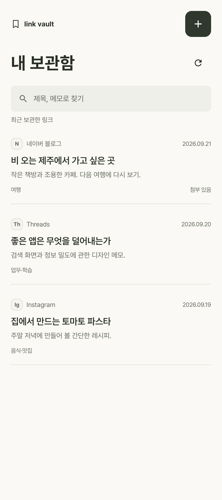
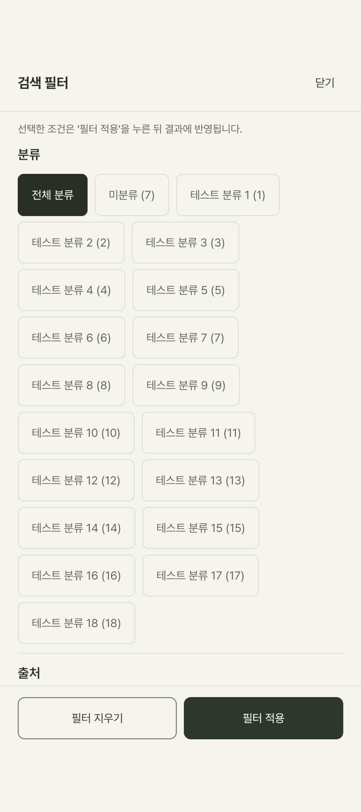
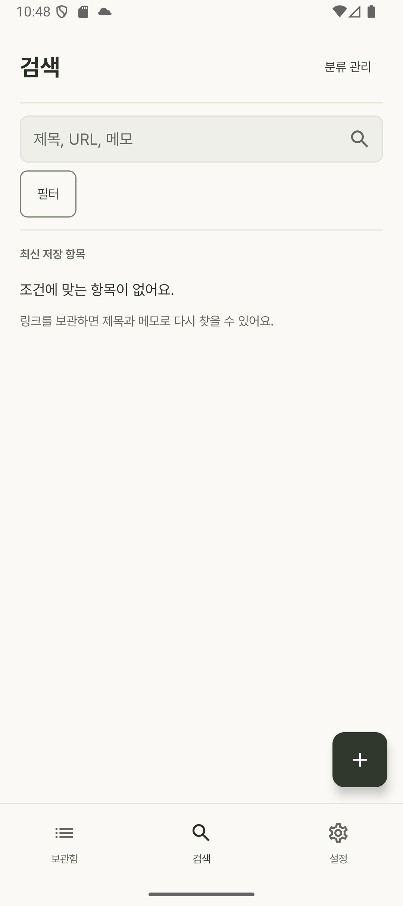
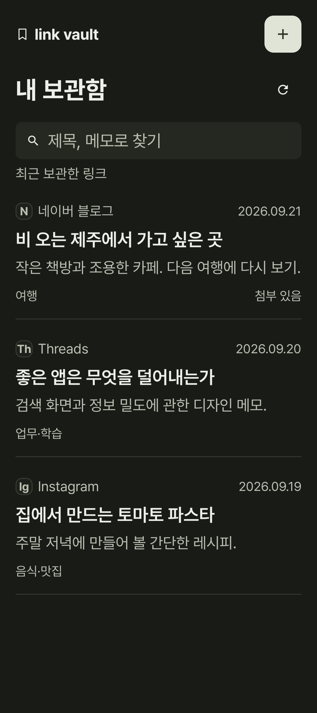
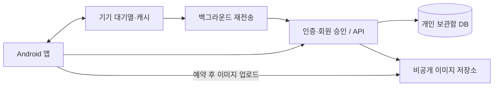

# Link Vault

**흩어진 링크를 모으고, 기억나는 단서로 다시 찾으세요.**

Android 공유 메뉴로 링크를 저장하고, 제목·메모·분류와 첨부 이미지의 인식 텍스트로
다시 찾는 개인 링크 보관함입니다. 찾은 링크는 원래 앱이나 브라우저에서 엽니다.

> **개발 중:** Google 로그인과 관리자 승인이 필요합니다.
> 실제 사용자 품질 평가와 운영 배포 인수는 미완료이며, 공개 출시·외부 베타 준비 완료 상태는 아닙니다.

[주요 기능](#주요-기능) · [시작하기](#시작하기) · [지원 범위](#지원-범위와-제한)

## 화면 미리보기

| 내 보관함 | 검색 필터 |
| :---: | :---: |
|  |  |
| 제목·출처·메모를 읽고 저장한 링크를 다시 찾습니다. | 조건을 고른 뒤 필터 적용으로 결과에 반영합니다. |

| 검색 · 결과가 없는 상태 | 다크 테마 · 큰 글꼴 |
| :---: | :---: |
|  |  |
| 제목·URL·메모로 검색하며, 결과가 없으면 안내를 표시합니다. | 어두운 배경과 큰 글꼴로 링크의 제목과 메모를 읽습니다. |

위 이미지는 **기존 QA 캡처**입니다. 내 보관함·검색 필터·다크 테마는
합성 자료로 실제 Compose 컴포넌트를 렌더링한 화면이며, 검색은 결과가 없는 상태의 앱 화면입니다.
실제 회원 자료나 SNS 앱 연동 성공의 증거는 아닙니다.

## 왜 Link Vault인가

관심 있는 글·장소·제품을 여러 앱에 저장하다 보면 **어디에 저장했는지부터 잊기 쉽습니다.**
Link Vault는 원문을 복제하는 대신 링크와 기억할 단서를 모읍니다.

- **한곳에 보관:** 출처가 달라도 링크를 같은 개인 보관함에 저장합니다.
- **기억으로 다시 찾기:** 제목·메모·확보한 메타정보·OCR 텍스트를 검색과 분류에 활용합니다.
- **원문으로 돌아가기:** 찾은 항목에서 원래 게시물을 엽니다.

원문 사이트의 로그인 요구나 게시물 삭제는 Link Vault에서 해결하지 않습니다.

## 사용 흐름

1. **공유하기:** 다른 앱의 Android 공유 메뉴에서 링크를 보내거나 URL을 붙여넣습니다.
2. **저장하기:** 링크를 확인하고 메모와 함께 저장합니다. 여러 링크가 있으면 하나를 선택합니다.
3. **다시 찾기:** 내 보관함에서 검색하거나 출처·기간·분류로 좁힙니다.
4. **원문 열기:** 찾은 항목을 원래 앱이나 브라우저에서 엽니다.

이미지를 첨부할 때는 저장된 항목과 사진을 직접 선택합니다.
연결이 끊기면 전송 대기 상태를 확인하고, 재연결 후 서버 저장 결과를 확인합니다.

## 주요 기능

| 기능 | 할 수 있는 일 |
| --- | --- |
| 빠르게 저장 | Android 공유 메뉴·URL 직접 입력, 제목·메모 편집 |
| 단서로 검색 | 키워드·정해진 별칭 검색, 출처·기간·분류·미분류 필터 |
| 내 방식으로 정리 | 규칙 기반 자동 분류, 사용자 분류 생성·수정, 직접 지정과 자동 분류 재적용 |
| 이미지로 단서 추가 | 항목당 이미지 1장 첨부·교체·삭제, 기기 내 한국어·라틴 OCR |
| 연결이 끊겨도 대기 | 저장·편집 등의 대기열, 마지막 서버 목록·상세 캐시와 동기화 시각 확인 |
| 데이터 관리 | 서버 항목 삭제, Google 재인증 기반 계정 탈퇴 |

앱은 `내 보관함`에서 시작합니다. 하단의 보관함·검색·설정과 별도 `링크 저장` 버튼으로 이동합니다.
라이트·다크 테마와 앱에 포함된 Pretendard를 사용합니다.

## 시작하기

### 이용 조건

- **Android 8.0 이상**이 필요합니다.
- Google 로그인 후 **관리자 승인**을 받아야 서버 보관함을 사용할 수 있습니다.
- 승인 회원 최대 6명의 초기 베타 설정입니다. 승인 대기는 오류가 아닙니다.
- 아래 개발용 빌드는 공개 배포나 외부 베타 참여 경로가 아닙니다.

### 개발자용 로컬 실행

Android Studio·JDK 17·Android SDK 35, Node.js 24와 Docker Desktop이 필요합니다.
Google OAuth 등록, 로컬 서버 설정, 앱 연결 설정을 마친 후 빌드합니다.

다음 순서로 진행하세요.

1. 개발 도구와 Google OAuth 클라이언트를 준비합니다.
2. 의존성을 설치하고 로컬 Supabase·마이그레이션·작업 실행기를 설정합니다.
3. 앱의 서버 주소·공개 API 키·Google 웹 Client ID를 설정합니다.
4. 아래 명령으로 빌드한 뒤 기기에 설치하고 로그인·회원 승인을 확인합니다.

```powershell
# 저장소 루트의 Windows PowerShell — 위 설정을 마친 후 실행
.\android\gradlew.bat -p android :app:assembleDebug
```

APK: `android/app/build/outputs/apk/debug/app-debug.apk`

**설정 없이도 빌드는 되지만 로그인·서버 보관함은 사용할 수 없습니다.**
Gradle은 루트 `.env`를 자동으로 읽지 않습니다. 앱에는 서버 비밀키를 넣지 마세요.

## 지원 범위와 제한

| 구분 | 현재 범위 |
| --- | --- |
| 플랫폼 | Android 전용. iOS·PC 웹은 현재 제공하지 않음 |
| 보관 한도 | 회원별 항목 100개, 새 항목 분당 10건. 사용자 분류 30개, 항목당 분류 연결 5개 |
| 자동 정보 확보 | 허용된 네이버 호스트의 제한된 공개 메타정보만 수집 |
| 검색·자동 분류 | 키워드·승인된 별칭·규칙 기반. 자연어 이해나 생성형 AI 분석이 아님 |
| 오프라인 | 대기열·캐시 지원. 오프라인 검색을 서버 검색 완료로 대체하지 않음 |
| 이미지 | 직접 선택한 이미지 1장. 회원별 서버 이미지 총량 20,000,000바이트 |
| 미지원 | SNS 좋아요·저장 자동 수집, 전체 본문·영상 분석, 다중 이미지 첨부, 휴지통·삭제 취소, 사용자 export |

### 개인정보와 삭제

- OCR은 기기에서 실행하지만 **첨부를 선택한 이미지와 인식 결과는 서버에 전송**됩니다.
- 서버 저장 완료와 기기 전송 대기, 이미지 저장 성공과 OCR 성공은 구분합니다.
- 삭제·탈퇴는 되돌릴 수 없으며, 백업을 포함한 모든 사본의 즉시 삭제를 보증하지 않습니다.
- 개인정보 안내는 개발용 초안이며 확정 처리방침이 아닙니다.

## 구조와 기술 스택



| 영역 | 기술 |
| --- | --- |
| Android UI | Kotlin 2.1.0, Jetpack Compose, Material 3 |
| 기기 저장·재전송 | Room 2.7.2, WorkManager 2.9.1 |
| 인증·통신 | Credential Manager, Google Identity, Supabase Auth, Ktor |
| 이미지 인식 | 번들된 ML Kit 한국어·라틴 OCR |
| 서버·데이터 | Supabase Edge Functions, TypeScript / Deno, PostgreSQL, RPC·RLS, pg_cron·pg_net, 비공개 Storage |
| 검증 | JVM·Compose 계측 시험, pgTAP, Deno·Node 테스트, 로컬 통합 시험 |

재전송 시 중복 저장을 방지하고, 오래된 편집으로 최신 자료를 덮어쓰지 않도록 설계했습니다.
회원·세션별로 기기 자료를 격리하며 자동 분류보다 사용자의 직접 선택을 우선합니다.
위 그림은 구현 구성의 요약이며 운영 배포 완료를 뜻하지 않습니다.

## 라이선스 안내

저장소 루트에 프로젝트 전체에 적용할 라이선스 파일이 명시되어 있지 않습니다.
글꼴 라이선스를 프로젝트 전체의 사용·재배포 허가로 해석하지 마세요.

Pretendard의 [OFL 라이선스](android/app/src/main/assets/licenses/pretendard-OFL.txt)는 앱에 포함되어 있으며,
설정의 `글꼴 라이선스`에서도 네트워크 연결 없이 읽을 수 있습니다.
