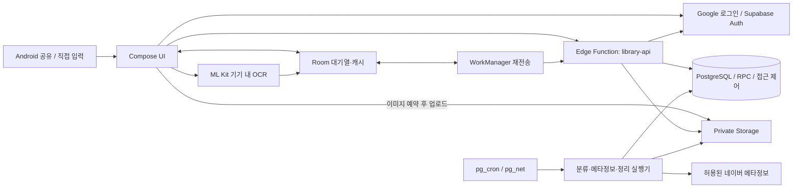

# 구조와 설계 원칙

[Link Vault 소개](../README.md) · [로컬 실행](development.md) · [검증](verification.md) · [운영](operations.md)

## 시스템 아키텍처

회원 인증·승인·소유권을 확인한 API와 SQL 계약으로 데이터를 보호합니다.
일반 클라이언트가 테이블에 직접 쓰지 않으며, 백그라운드 작업은 임대·재시도·버전을 확인해 반영합니다.
위 그림은 구현 구성이고 운영 배포 완료를 나타내지 않습니다.

## 핵심 기술적 의사결정

### 1. 연결이 끊겨도 요청의 의미를 바꾸지 않기

저장·편집 요청을 Room에 먼저 기록하고 WorkManager가 **같은 회원·요청 ID·본문**으로 재전송합니다.
응답 유실과 중복 전송 때문에 새 항목이 반복 생성되거나 기존 메모가 덮어써지는 것을 막습니다.
자동 전송은 생성 후 24시간까지이며, 만료 후에는 사용자의 재확인이 필요합니다.

### 2. 오래된 편집과 응답으로 최신 자료를 덮어쓰지 않기

편집은 `expected_version`으로 보호하고, 충돌하면 최신 내용을 확인한 뒤 새 요청으로 저장합니다.
늦게 도착한 낮은 버전의 응답은 최신 캐시를 덮어쓰지 않습니다.
로그아웃·계정 변경 시 기기 자료를 정리하고, 회원과 세션 경계로 대기 작업을 격리합니다.

### 3. 실제로 확보한 정보만 검색 단서로 사용하기

메타정보는 허용 호스트·공인 IP·TLS·시간·크기 제한을 적용해 읽습니다.
전체 본문이나 원격 이미지를 수집했다고 표시하지 않으며, OCR 실패를 이미지 저장 실패와 혼동하지 않습니다.
자동 분류보다 사용자의 직접 선택을 우선하고, 검색·분류의 일치 근거를 확인할 수 있게 합니다.

### 4. 삭제한 자료가 복원으로 되살아나지 않게 하기

항목 삭제는 원문·메모·검색 파생값·OCR을 지우고 후속 파일 정리를 진행합니다.
계정 탈퇴는 Google 재인증을 거쳐 접근을 차단한 후 파일·업무 데이터·Auth 계정을 정리합니다.
암호화 백업의 격리 복원에서는 삭제 기록을 적용하고 DB·파일·사용량을 검증합니다.
로컬 백업의 DB 덤프와 이미지 목록은 같은 읽기 전용 PostgreSQL 스냅샷을 사용합니다.
삭제 기록에 대응하는 행이 이미 없어도 삭제 묘비와 잔존 자료를 검사하며,
잠금 대기·덤프 실행 제한을 초과하면 불완전한 백업을 성공으로 게시하지 않습니다.
로컬 리허설 성공은 운영 백업·외부 키 보관·물리 폐기 검증을 대신하지 않습니다.
운영 서버 전체 스냅샷의 서비스 중지·복구 절차는 [운영 안내](operations.md#백업과-서버-이전)를 참고하세요.

## 구현과 계약

| 목적 | 소스·기록 |
| --- | --- |
| DB·접근 권한 | [마이그레이션](../supabase/migrations) · [DB 계약 시험](../supabase/tests) |
| API 계약 | [요청 처리](../supabase/functions/library-api/handler.ts) · [계약 시험](../supabase/functions/library-api/handler_test.ts) |
| 검색·분류 | [검색·분류 엔진](../supabase/functions/library-api/discovery-engine.ts) · [규칙](../supabase/functions/library-api/rules.json) |
| 재시도·동시성 | [보관 안정성](development-record.md#m2-보관-안정성) · [작업 실행기](development-record.md#백그라운드-실행기와-기존-분류-정규화) |
| 로컬 백업·복원 | [로컬 운영과 백업 리허설](development-record.md#m5-로컬-운영백업-리허설) — 운영 장애 복원 명령이 아님 |

기획 원본은 저장소의 로컬 보관 정책에 따라 공개 대상에서 제외합니다.
위 링크는 공개 대상 파일만 사용하며, 개발 기록에 적힌 기획 문서 경로·내부 아티팩트 번호는 공개 링크가 아닙니다.
